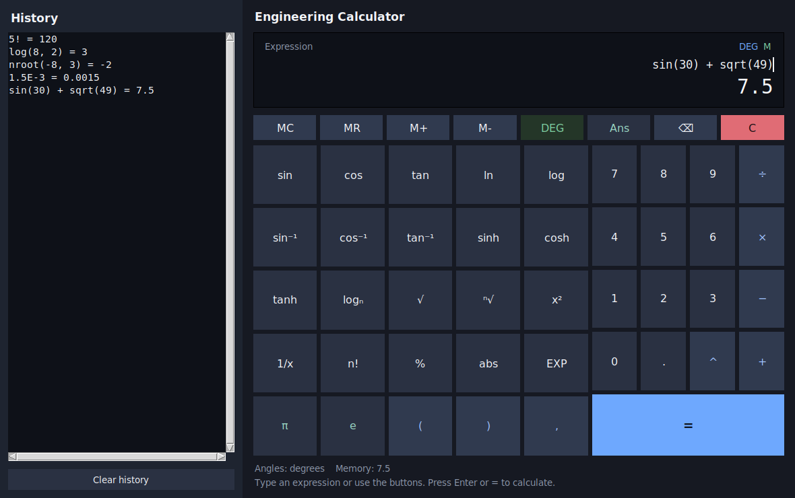

# Engineering Calculator

A desktop scientific calculator written in Python. The window uses Tkinter, which comes with Python, and the maths lives in a separate engine so it can be tested without opening a window.



## Features

- Expression display and a large result line
- Button grid, plus typing on the keyboard (Enter or `=` to calculate, Esc to clear, Backspace to delete)
- History of past calculations; click a row to load it again
- `+` `-` `*` `/` `^` and parentheses
- `sqrt`, nth root (`nroot`), `x²`, `1/x`, percent (`%`), factorial (`!`), and `abs`
- `sin` `cos` `tan` and inverses (`asin`, `acos`, `atan`, or `arcsin`, `arccos`, `arctan`)
- `sinh` `cosh` `tanh` (these are not angles)
- `log10`, `ln`, and `log(x, base)`
- `exp`, `pi`, `e`, and `Ans` (the previous result)
- Memory: `M+`, `M-`, `MR`, `MC`
- Degrees / radians toggle for sin, cos, tan and their inverses
- Scientific notation with the `EXP` key, for example `6.02E23`
- Clear and backspace
- Friendly errors for division by zero, domain errors, and mistyped expressions

Expressions are not passed to Python's `eval`. The engine tokenizes the text, parses an abstract syntax tree, and runs only an allowed list of operations. See `calculator/engine.py` for the steps, written so you can read them from top to bottom.

## Install and run

You need Python 3.10 or newer. No third-party packages are required to run the app.

On Ubuntu, Tkinter is often packaged separately:

```bash
sudo apt install python3 python3-tk
```

From this folder, start the window with either command:

```bash
python3 main.py
```

```bash
python3 -m calculator
```

You can also try the engine from a Python shell, with no window:

```python
from calculator import Calculator

calc = Calculator()
print(calc.evaluate("sin(30) + sqrt(49)"))  # 7.5, degrees are the default
```

## Expressions

| You write | Meaning | Result |
| --- | --- | --- |
| `2 + 3 * 4` | Multiplication before addition | `14` |
| `(2 + 3)^2` | Power | `25` |
| `2^3^2` | Powers group to the right: `2^(3^2)` | `512` |
| `50%` | Percent, divide the value on the left by 100 | `0.5` |
| `(5+2)%` | Percent of the whole parentheses | `0.07` |
| `5!` | Factorial | `120` |
| `sqrt(49)` | Square root | `7` |
| `nroot(8, 3)` | Cube root of 8 | `2` |
| `nroot(-8, 3)` | Odd roots of negatives are allowed | `-2` |
| `log(1000)` or `log10(1000)` | Base-10 logarithm | `3` |
| `log(8, 2)` | Logarithm of 8 in base 2 | `3` |
| `ln(e)` | Natural logarithm | `1` |
| `sin(30)` | Sine, in the current angle mode | `0.5` in degrees |
| `2pi` | Implicit multiplication | about `6.28` |
| `1.5E-3` | Scientific notation | `0.0015` |
| `Ans` | Previous successful result | |

A few rules that are easy to trip over:

- `%` and `!` apply only to the value directly on their left. `5+2%` is `5.02`, not `7%`. Use parentheses when you want the operator to cover a whole sum.
- `3!!` means factorial of factorial (`(3!)!`), not the double-factorial function.
- `2e` is rejected, because it looks like an unfinished exponent. Write `2e3` for 2000, or `2*e` to multiply by Euler's number.
- Negative numbers raised to a fractional power are not real here. Use `nroot(x, n)` for odd roots.
- Results that are not integers are kept to 12 significant digits, so `0.1 + 0.2` displays as `0.3`. Integers, including factorials, stay exact. Factorial is limited to 0 through 1000. Expressions longer than 500 characters, and powers that would have thousands of digits, are refused with an explanation.

The `x²` key squares the whole expression (`2+3` becomes `(2+3)^2`). The `1/x` key wraps it as `1/(...)`. Both wait for `=` so you can see the expression before it runs.

`DEG` / `RAD` changes sin, cos, tan and the inverse functions. Hyperbolic functions ignore that switch. Degrees are the default.

Memory uses the number on screen. `M+` and `M-` calculate the current expression first when it has not just been evaluated. `MR` inserts the stored value. `MC` sets memory back to 0. `C` clears the expression only; Ans, memory, and history stay. Esc does the same thing.

## Tests

Install pytest, then run it from this folder:

```bash
pip install pytest
pytest
```

`requirements-dev.txt` lists that same test dependency. The engine tests do not need a display. The window tests open a real Tk window and are skipped if Tk cannot start.

## Project layout

```
main.py                 # python main.py
calculator/engine.py    # parser and maths, no Tk
calculator/gui.py       # the window
calculator/__main__.py  # python -m calculator
tests/test_engine.py    # unit tests for the maths
tests/test_gui.py       # keys, history, memory, and launch
```

## 繁體中文

這是一個用 Python 寫的工程／科學計算機。視窗使用標準函式庫 Tkinter，計算與畫面是分開的：`calculator/engine.py` 負責運算，`calculator/gui.py` 負責按鈕與顯示。

算式不會直接交給 Python 的 `eval`。程式先把文字拆成代幣（token），再轉成語法樹，只執行允許的數字、運算子與函式。除以零、對數或根號的定義域錯誤、括號不成對，都會顯示簡短的說明，而不是一長串程式錯誤。

需要 Python 3.10 以上。在 Ubuntu 上若無法開啟視窗，請先安裝 Tkinter：

```bash
sudo apt install python3 python3-tk
```

啟動：

```bash
python3 main.py
```

或：

```bash
python3 -m calculator
```

測試（需另外安裝 pytest，計算機本身沒有第三方套件）：

```bash
pip install pytest
pytest
```

角度預設為度（DEG）。`%` 是百分比，`!` 是階乘，`nroot(x, n)` 是 n 次方根，`log(x, base)` 是指定底的對數。`Ans` 是上一次成功的結果，`M+` `M-` `MR` `MC` 是記憶體。

## License

MIT. See [LICENSE](LICENSE).
